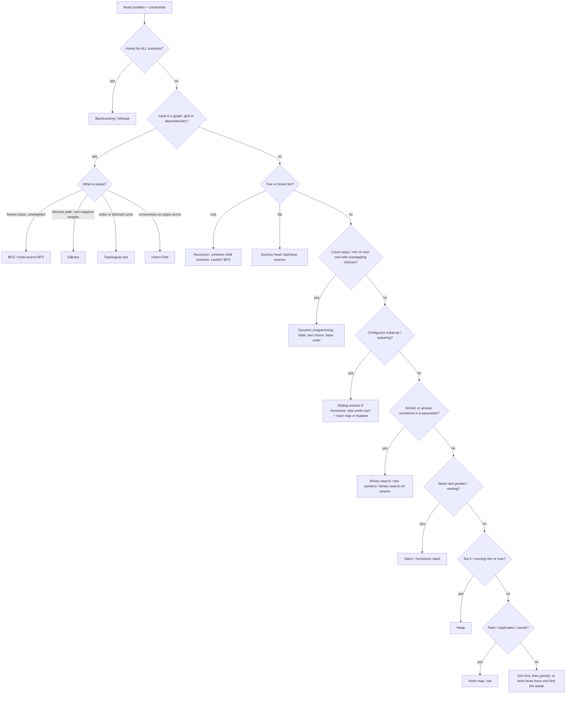

# 00 - Pattern finder: how to recognise which technique a problem wants

> You do not "know" patterns - you **recognise signals**. This page turns problem statements into candidate techniques in under two minutes.

## Step 0 - The 60-second routine
1. **Restate** the problem and write 2 tiny examples by hand.
2. **Constraints:** read `n` -> allowed complexity (table A).
3. **Input shape:** array? string? sorted? linked list? tree? graph? grid? intervals? (table B)
4. **Question wording:** what are you asked for - count / min / max / all / exists / order? (table C)
5. **Brute force:** write it in one line; find the *repeated work*. The pattern removes exactly that.
6. Pick the top 1-2 candidates, check each against a counter-example, then code.

## A. Constraints -> complexity -> technique
| n | Complexity target | Candidates |
|---|---|---|
| <= 10 | n!, n^n | permutations, backtracking |
| <= 20 | 2^n * n | **bitmask / subsets**, backtracking, meet in the middle |
| <= 500 | n^3 | Floyd-Warshall, interval DP |
| <= 5,000 | n^2 | 2-D DP, all pairs, LCS / edit distance |
| <= 10^5 - 10^6 | n log n / n | sort, **heap**, **binary search**, **two pointers**, **sliding window**, **hash map**, prefix sums, union-find, monotonic stack |
| <= 10^9 or "huge" | log n / O(1) | **binary search on answer**, math, fast power |

## B. Input shape -> candidates
| Input looks like | Think first of |
|---|---|
| **Sorted array** (or can be sorted cheaply) | binary search, two pointers (opposite ends), merge, greedy |
| **Unsorted array**, pairs/duplicates/counts | **hash map / set**, sorting, prefix sums |
| **Contiguous subarray / substring** | **sliding window** (non-negative values), prefix sum + hash map (with negatives), Kadane |
| **Array with values in 1..n** | cyclic sort / in-place hashing, XOR/sum trick |
| **String** (match / palindrome / anagram) | hash map of counts, sliding window, two pointers, KMP, DP (LCS / palindromes), trie |
| **Two strings/sequences** | 2-D DP, two pointers |
| **Linked list** | dummy head, fast/slow pointers, reverse, merge |
| **Brackets / nesting / "next greater"** | **stack / monotonic stack** |
| **Intervals** | sort by start/end, merge, sweep line, greedy, heap of end times |
| **Tree** | DFS recursion (post-order combine), BFS by levels, BST property, LCA |
| **Graph / grid / dependencies** | BFS/DFS, topological sort, union-find, Dijkstra |
| **"Design a class ... O(1)"** | hash map + linked list/array/heap/trie combination |
| **Small set, "all subsets/arrangements"** | backtracking / bitmask |
| **Numbers, bits, "without extra space"** | XOR, masks, math identities |

## C. Wording -> candidates (the big lookup table)
| If the statement says ... | Likely technique | Notes id |
|---|---|---|
| "two numbers that add up to", "pair with difference" | hash map (unsorted) / two pointers (sorted) | 01, 03 |
| "contains duplicate", "first unique", "group by" | hash set / map, canonical key | 01 |
| "subarray sum equals k", "number of subarrays with ..." | prefix sum + hash map | 02 |
| "range sum", "everything except self" | prefix / suffix arrays | 02 |
| "longest / shortest substring such that ..." | variable sliding window | 04 |
| "window of size k", "every k consecutive" | fixed sliding window, monotonic deque for max/min | 04, 07 |
| "at most k distinct" / "exactly k" | window; exactly = atMost(k) - atMost(k-1) | 04 |
| "maximum subarray", "best contiguous" | Kadane | 05 |
| "missing / duplicate number", "values in 1..n", "O(1) space" | cyclic sort, sum/XOR, Floyd | 05, 08 |
| "sorted ... O(log n)", "find first/last position" | binary search | 06 |
| "minimum **maximum**", "smallest x such that feasible", "minimum speed/capacity/days" | **binary search on the answer** | 06 |
| "rotated sorted array" | binary search + which half is sorted | 06 |
| "valid parentheses", "nested", "decode", "evaluate expression" | stack | 07 |
| "next greater/smaller", "days until warmer", "largest rectangle", "stock span" | monotonic stack | 07 |
| "sliding window maximum" | monotonic deque | 07 |
| "cycle in a list", "middle node", "k-th from end" | fast & slow pointers / gap pointers | 08 |
| "reverse", "reorder", "merge sorted lists" | pointer rewiring + dummy | 08 |
| "merge overlapping", "insert interval", "meeting rooms" | sort + sweep / heap / sweep line | 09 |
| "minimum number to remove so that ..." (intervals) | greedy by end | 09, 10 |
| "can you reach", "minimum jumps", "schedule" | greedy (prove it!) | 10 |
| "k-th largest", "top k", "k closest", "merge k sorted" | heap | 11 |
| "median of a stream" | two heaps | 11, 18 |
| "depth / height / diameter / path sum / ancestor" | tree recursion (post-order) | 12 |
| "level order", "right-side view", "shortest in a tree" | BFS | 12 |
| "valid BST", "k-th smallest in BST" | bounds recursion / in-order | 12 |
| "generate all", "list every", "all combinations/permutations/subsets" | backtracking | 13 |
| "number of islands", "regions", "flood fill" | DFS/BFS on a grid | 14 |
| "fewest steps / minimum moves" (unweighted) | BFS | 14 |
| "prerequisites", "order of tasks", "is there a cycle (directed)" | topological sort | 14 |
| "connected components", "redundant edge", "are x and y connected" | union-find | 14 |
| "shortest path with weights", "network delay", "cheapest route" | Dijkstra (Bellman-Ford if negative / k stops) | 14 |
| "minimum cost to connect all" | MST (Kruskal + DSU) | 14 |
| "number of ways", "minimum cost/coins", "longest ... subsequence", "is it possible" with overlapping choices | **dynamic programming** | 15 |
| "partition into equal subsets", "target sum" | 0/1 knapsack | 15 |
| "unlimited supply of items" | unbounded knapsack | 15 |
| "edit distance", "common subsequence", "interleaving" | 2-D DP on two strings | 15 |
| "burst / merge / split a range, choose the last" | interval DP | 15 |
| "buy and sell stock with ..." | state-machine DP | 15 |
| "single number", "power of two", "count set bits", "subsets of a small set" | bit manipulation | 16 |
| "pow(x, n)", "modulo 10^9+7", "primes", "gcd" | fast exponentiation, sieve, Euclid | 16 |
| "find pattern in text", "longest prefix that is also suffix" | KMP / prefix function | 17 |
| "design LRU / cache / stack with min / trie / randomized set" | hash map + list / augmented structure | 18 |
| "count pairs i<j with a[i] > ...", "inversions" | merge-sort counting / Fenwick | 19 |

## D. Decision flowchart

## E. Confusable pairs - tie-breakers
| You hesitate between | Decide with |
|---|---|
| **Sliding window vs prefix sum + hash** | Negative numbers? -> prefix + hash. Only non-negative and "longest/shortest"? -> window. |
| **Two pointers vs binary search** | Pairs in a sorted array -> two pointers (O(n)). Single element/boundary lookup -> binary search. |
| **BFS vs DFS** | Fewest steps / shortest unweighted path / levels -> BFS. Explore everything, components, paths, backtracking -> DFS. |
| **Greedy vs DP** | Can you *prove* the local choice? (exchange argument) -> greedy. Counter-example in 2 minutes? -> DP. |
| **DP vs backtracking** | Need *all* solutions -> backtracking. Need a count/min/max and states repeat -> DP. |
| **Heap vs sort** | Need only top-k or a running extreme/stream -> heap. Need everything ordered once -> sort. |
| **Union-Find vs DFS** | Edges arrive incrementally / many connectivity queries -> DSU. One static graph -> DFS/BFS. |
| **Dijkstra vs BFS vs Bellman-Ford** | Unweighted -> BFS. Non-negative weights -> Dijkstra. Negative edges or "at most k edges" -> Bellman-Ford. |
| **Stack vs recursion** | They are the same thing; use an explicit stack to avoid recursion-depth limits. |
| **Memoised recursion vs bottom-up DP** | Memoised if the visiting order is unclear or only some states are needed; bottom-up for speed and O(1)-row memory tricks. |

## F. Spot-the-pattern drill (cover the right column and answer)
1. "Longest substring with at most 2 distinct characters." -> *variable sliding window + counter.*
2. "Minimum days to ship all packages within capacity." -> *binary search on the answer.*
3. "Number of ways to make change." -> *unbounded knapsack DP (combinations).*
4. "Can the courses be completed?" -> *topological sort / cycle detection.*
5. "Merge k sorted lists." -> *min-heap of heads (k-way merge).*
6. "Smallest window containing all characters of t." -> *variable window + need counter.*
7. "Find the duplicate in an array of n+1 numbers in 1..n, O(1) space, do not modify." -> *Floyd's cycle detection.*
8. "Largest rectangle in a histogram." -> *monotonic increasing stack.*
9. "Count pairs with a[i] > 2*a[j], i < j." -> *merge-sort counting.*
10. "All valid arrangements of n queens." -> *backtracking with sets for pruning.*

## G. Stuck? Walk this list
1. Can I solve a **smaller** version by hand? What did I do?
2. Can I solve it if the input is **sorted**? Then should I sort first?
3. What is the **brute force** and where does it **repeat work**? (Cache it -> DP/hash. Skip it -> two pointers/greedy. Order it -> sort/heap.)
4. Can I **reverse** the question (answer -> check) -> binary search on the answer.
5. Does the problem have **structure** I ignored: a graph hiding in the statement, a tree, a monotone property, a known range 1..n?
6. What if I process in the **opposite direction** (right-to-left, last-choice-first)?
7. Am I missing a **counter-example** to my idea? Try empty, one element, duplicates, negatives.

## H. Pattern index (where to learn each)
| # | Topic | Practice ids |
|---|---|---|
| 01 | [hashing](01-hashing.md) | `hashing/1` ... `hashing/25` |
| 02 | [prefix_sums](02-prefix_sums.md) | `prefix_sums/1` ... `prefix_sums/19` |
| 03 | [two_pointers](03-two_pointers.md) | `two_pointers/1` ... `two_pointers/28` |
| 04 | [sliding_window](04-sliding_window.md) | `sliding_window/1` ... `sliding_window/29` |
| 05 | [array_tricks](05-array_tricks.md) | `array_tricks/1` ... `array_tricks/16` |
| 06 | [binary_search](06-binary_search.md) | `binary_search/1` ... `binary_search/34` |
| 07 | [stack_monotonic](07-stack_monotonic.md) | `stack_monotonic/1` ... `stack_monotonic/34` |
| 08 | [linked_list](08-linked_list.md) | `linked_list/1` ... `linked_list/33` |
| 09 | [intervals](09-intervals.md) | `intervals/1` ... `intervals/19` |
| 10 | [greedy](10-greedy.md) | `greedy/1` ... `greedy/30` |
| 11 | [heap](11-heap.md) | `heap/1` ... `heap/23` |
| 12 | [trees](12-trees.md) | `trees/1` ... `trees/57` |
| 13 | [backtracking](13-backtracking.md) | `backtracking/1` ... `backtracking/30` |
| 14 | [graphs](14-graphs.md) | `graphs/1` ... `graphs/43` |
| 15 | [dynamic_programming](15-dynamic_programming.md) | `dynamic_programming/1` ... `dynamic_programming/60` |
| 16 | [bits_math](16-bits_math.md) | `bits_math/1` ... `bits_math/35` |
| 17 | [strings](17-strings.md) | `strings/1` ... `strings/37` |
| 18 | [design](18-design.md) | `design/1` ... `design/29` |
| 19 | [divide_conquer](19-divide_conquer.md) | `divide_conquer/1` ... `divide_conquer/3` |
| 20 | [matrix](20-matrix.md) | `matrix/1` ... `matrix/24` |
